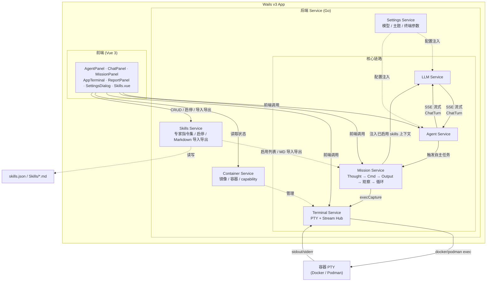

# GYcore 开发者文档

面向源码贡献者、二次开发者。产品介绍、用户指南、Skills 使用说明请先看 [README.md](./README.md)。

***

## 目录

- [技术栈](#技术栈)
- [架构概览](#架构概览)
- [项目结构](#项目结构)
- [开发环境](#开发环境)
- [开发模式](#开发模式)
- [后端 Service 实现](#后端-service-实现)
- [前端组件](#前端组件)
- [Skills 实现细节](#skills-实现细节)
- [构建与打包](#构建与打包)
- [测试](#测试)

***

## 技术栈

| 层级 | 技术 | 说明 |
|---|---|---|
| 桌面框架 | [Wails v3](https://v3.wails.io/) | Go + WebKit 混合桌面，自动生成 TS 绑定 |
| 后端 | Go 1.26 | 所有 Service 代码 |
| 前端 | Vue 3 + TypeScript + Vite | xterm.js 终端、i18n 中/英双语 |
| 容器后端 | Docker CLI / Podman CLI | 通过 exec 模式运行命令 |
| PTY | [creack/pty](https://github.com/creack/pty) | Go 原生 PTY 实现 |
| LLM 协议 | OpenAI 兼容 API (SSE 流式) | 统一处理 `reasoning_content` / `thinking` 字段 |
| 打包 | nfpm / MSIX / dmgbuild / linuxdeploy | 多平台安装包 |
| 前端绑定 | `wails3 generate bindings` | 自动生成 `frontend/bindings/` 下的 TS 桩 |

***

## 架构概览



七个核心 Service（全在 `server/` 目录下）：

| Service | 文件 | 职责 |
|---|---|---|
| `AgentService` | `agentservice.go` | Agent CRUD、对话流式推送、范围限制注入 |
| `LLMService` | `llmservice.go` | OpenAI 兼容 API 调用，SSE 流式解析，多供应商字段适配 |
| `MissionService` | `missionservice.go` | 自主任务引擎：循环 thought→command→observation，步数/超时/截断保护 |
| `TerminalService` | `terminalservice.go` | PTY 会话管理，Stream Hub 多前端订阅同一份输出 |
| `ContainerService` | `containerservice.go` | 镜像与容器管理，Docker/Podman 后端透明切换 |
| `SettingsService` | `settingsservice.go` | 模型、主题、终端参数的持久化 |
| `SkillsService` | `skillsservice.go` | 专家指令集 CRUD、启停、排序、Markdown 导入导出，向 Mission 注入已启用 skills 上下文 |

***

## 项目结构

```
GYcore-Projet/
├── main.go                     # Wails 入口 + Linux 图标/desktop 自安装
├── server/                     # 后端 Service (Go)
│   ├── agentservice.go         # Agent 管理 + 对话
│   ├── agentservice_test.go
│   ├── authservice.go          # 凭据加密存储
│   ├── authservice_proxy_other.go   # 跨平台编译垫片
│   ├── authservice_proxy_windows.go
│   ├── containerservice.go     # 容器后端封装
│   ├── contextmanager.go       # 上下文窗口管理
│   ├── llmservice.go           # 模型调用 + 流式解析
│   ├── missionservice.go       # 自主渗透任务引擎
│   ├── missionservice_test.go
│   ├── ptycheck_test.go
│   ├── settingsservice.go      # 设置持久化
│   ├── skillsservice.go        # Skills 指令集 CRUD / 启停 / MD 导入导出
│   ├── terminal_platform_other.go   # PTY 平台差异化
│   ├── terminal_platform_windows.go
│   └── terminalservice.go      # PTY 终端会话
├── Skills/                     # 预置 skill 文件（可选，通过 UI 导入）
│   ├── sql_injection.md
│   └── ...
├── gycontaniner/               # GYcore 工作容器构建
│   ├── docker/
│   │   ├── Dockerfile          # Kali Rolling + kali-linux-labs + kali-linux-default
│   │   ├── entrypoint.sh       # 外挂卷首次挂载时补齐骨架
│   │   └── profile.sh          # shell 历史持久化 / 别名
│   └── podman/
│       └── Containerfile
├── frontend/                   # Vue 3 前端
│   ├── src/
│   │   ├── App.vue             # 主布局 + Rail 切换 + 事件绑定
│   │   ├── components/
│   │   │   ├── AgentDialog.vue
│   │   │   ├── AgentPanel.vue
│   │   │   ├── AppRail.vue
│   │   │   ├── AppTerminal.vue
│   │   │   ├── ChatPanel.vue
│   │   │   ├── icons.ts
│   │   │   ├── LoginView.vue
│   │   │   ├── MarkdownView.vue
│   │   │   ├── MissionPanel.vue
│   │   │   ├── ReportPanel.vue
│   │   │   ├── SettingsDialog.vue
│   │   │   ├── Skills.vue
│   │   │   └── Splitter.vue
│   │   └── i18n.ts             # 中/英双语
│   ├── bindings/               # wails3 generate 自动生成的 TS 调用桩
│   │   └── gycore/server/
│   │       ├── models.ts       # 后端结构体的 TS 接口定义
│   │       ├── *.ts            # 每个 Service 一个绑定文件
│   │       └── index.ts
│   └── package.json
├── build/                      # 打包配置
│   ├── config.yml              # Wails v3 全局配置
│   ├── Taskfile.yml            # 通用构建任务
│   ├── appicon.png
│   ├── linux/                  # desktop 文件 + nfpm.yaml
│   ├── windows/                # icon.ico + manifest + MSIX
│   ├── darwin/                 # icons.icns + Info.plist + dmgbuild
│   ├── docker/                 # 构建跨平台编译镜像
│   ├── ios/                    # iOS 壳（预留）
│   └── android/                # Android 壳（预留）
├── Taskfile.yml                # 顶层任务入口
└── Developer.md                # 本文档
```

***

## 开发环境

- Go ≥ 1.26
- Node.js ≥ 20
- Wails v3：
  ```bash
  go install github.com/wailsapp/wails/v3/cmd/wails3@latest
  ```
- Docker 或 Podman（可选，用于构建工作容器）

克隆仓库：

```bash
git clone https://github.com/xiguayiqiu/GYcore.git
cd GYcore/GYcore-Projet
```

***

## 开发模式

### 一体化开发

```bash
wails3 dev -config ./build/config.yml
```

Wails 自动：
1. 后台任务 `common:dev:frontend` 实时编译前端到 `frontend/dist`
2. 主进程编译 Go 后端 embed 前端产物
3. 启动桌面窗口，Go/前端热重载

前端默认 dev server 端口可通过 `WAILS_VITE_PORT` 环境变量覆盖，默认 9245。

### 前端单独开发

```bash
cd frontend
npm install
npm run dev        # Vite dev server
npm run build      # 输出到 dist/
```

### 生成前端绑定

后端 Service 新增/修改方法后，重新生成 TS 桩：

```bash
wails3 generate bindings
```

产物写入 `frontend/bindings/gycore/server/`，**不要手动编辑**。

***

## 后端 Service 实现

### 通用模式

每个 Service 遵循相同的生命周期：

```go
// 1. 定义结构体
type SkillsService struct {
    dataDir string
    skills map[string]*Skill
}

// 2. New 构造 + load 从磁盘恢复状态
func NewSkillsService(dataDir string) (*SkillsService, error) { ... }

// 3. 每个公开方法被 Wails 自动暴露给前端
func (s *SkillsService) List() ([]Skill, error) { ... }
func (s *SkillsService) Create(name, desc, prompt string, tags []string) (Skill, error) { ... }

// 4. 每次写操作后持久化
func (s *SkillsService) save() error { ... }
```

### 持久化路径

所有配置文件通过 `os.UserConfigDir()` + `gycore/` 子目录统一放置：

| 平台 | 路径 |
|---|---|
| Linux | `~/.config/gycore/` |
| Windows | `%APPDATA%/GYcore/` |
| macOS | `~/Library/Application Support/GYcore/` |

| 文件 | Service | 用途 |
|---|---|---|
| `settings.json` | `SettingsService` | API 地址、Key、模型、主题、终端参数 |
| `agents.json` | `AgentService` | Agent 定义（名称、容器、模型、角色设定） |
| `skills.json` | `SkillsService` | 所有 skill（含内置 + 自定义），含 `enabled` 和排序 |

### 跨平台垫片

Windows 需要不同的 PTY 和凭据处理，用 Go build tag 拆文件：

```
authservice.go               # 通用实现
authservice_proxy_other.go  # //go:build !windows
authservice_proxy_windows.go # //go:build windows
```

### SSE 流式输出

LLM Service 和 Agent Service 通过 Go channel 推送事件，前端用 `EventSource`（或 fetch 流式）消费。`ChatTurn` 结构体：

```go
type ChatTurn struct {
    Role    string `json:"role"`
    Content string `json:"content"`
    ReasoningContent string `json:"reasoning_content,omitempty"`
    Thinking         string `json:"thinking,omitempty"`
    Done    bool   `json:"done,omitempty"`
}
```

不同供应商的字段统一归并：deepseek 返回 `reasoning_content`，qwen 返回 `thinking`，其他供应商可能在 `reasoning` 里嵌套。统一展开后传给前端。

### Mission 循环

`missionservice.go` 的核心循环：

```go
for step := 0; step < maxSteps; step++ {
    // 1. LLM 生成当前步的 thought + command
    turn := s.llm.Complete(ctx, turns)

    // 2. 执行命令，捕获输出
    output := s.terminal.ExecCapture(ctx, turn.Command)

    // 3. 把 observation 追加回 turns
    turns = append(turns, ChatTurn{Role: "user", Content: output})

    // 4. 检查终止条件（LLM 输出 task_complete、步数超限、超时）
}
```

`generatePlan`（拆解阶段）和 `buildTurns`（执行阶段）**双入口注入** skills 上下文。

***

## 前端组件

| 组件 | 职责 |
|---|---|
| `App.vue` | 主布局、Rail 切换、事件总线 |
| `AppRail.vue` | 左侧导航：Agent / Chat / Mission / Terminal / Report / Skills / Settings |
| `AgentPanel.vue` + `AgentDialog.vue` | Agent 列表与新建/编辑弹窗 |
| `ChatPanel.vue` | 对话区，SSE 流式渲染，含 reasoning_content 折叠显示 |
| `MissionPanel.vue` | 任务执行面板，每步 thought → cmd → output 卡片式展示 |
| `AppTerminal.vue` | xterm.js 终端，分本地 shell / 容器 shell 两个 Tab |
| `ReportPanel.vue` | Findings 结构化展示，Markdown / JSON 导出 |
| `SettingsDialog.vue` | API 配置、主题切换、终端参数 |
| `Skills.vue` | Skills 管理面板（详见下文） |
| `MarkdownView.vue` | 通用 Markdown 渲染（用于报告、skill 详情预览） |
| `Splitter.vue` | 可拖拽分割面板容器 |

所有组件使用 scoped CSS，主题通过 `html[data-theme="light/dark"]` 切换，CSS 变量定义在全局样式。

### 前端 → 后端调用

Wails 自动生成的 `bindings/gycore/server/*.ts`：

```typescript
// 调用后端 SkillsService.List()
import { List } from '../bindings/gycore/server/skillsservice'
const skills = await List()

// 调用后端 SkillsService.SetEnabled(id, true)
import { SetEnabled } from '../bindings/gycore/server/skillsservice'
await SetEnabled('abc123', true)
```

**不要**在前端直接访问后端结构体字段，通过 binding 暴露的方法间接操作。

***

## Skills 实现细节

### 后端数据结构

```go
// server/skillsservice.go

type Skill struct {
    ID      string   `json:"id"`       // sha1(name) 生成，稳定可复现
    Name    string   `json:"name"`
    Desc    string   `json:"desc"`
    Prompt  string   `json:"prompt"`
    Tags    []string `json:"tags"`
    Enabled bool     `json:"enabled"`  // 默认 true
}
```

ID 用 `sha1(name + "|" + desc)[:16]` 生成，**同一个 skill 多次导入不会重复创建**，只会更新。

### 持久化

`skills.json` 格式：

```json
{
  "skills": [
    {
      "id": "a1b2c3...",
      "name": "Nmap 扫描专家",
      "desc": "对目标进行全端口扫描与服务识别",
      "prompt": "...",
      "tags": ["nmap", "recon"],
      "enabled": true
    }
  ]
}
```

- 首次运行不存在 → `load()` 自动写入 6 个内置 skill
- 兼容旧数据：缺 `enabled` 字段时默认 `true`
- 任何写操作后立即 `save()`

### 前端启停交互

toggle switch 操作链（≤200ms）：

```
用户点击 toggle
  → setEnabled(skill.id, newState)
    → 乐观更新 skill.enabled = newState（无需等后端）
    → await binding.SetEnabled(id, newState)
      → 后端 s.skills[id].enabled = enabled
      → 后端 s.save() 写磁盘
```

### Markdown 导入解析

`parseSkillsMarkdown` 支持两种格式：

**格式 A：YAML front matter（单 skill）**
```
---
name: xxx
desc: xxx
tags: [a, b]
prompt: |
  内容……
---
```

**格式 B：## 标题分隔（多 skill 批量）**
```
## 标题1

内容1

## 标题2

内容2
```

解析流程：
1. 检测 `---` 开头 → 走 YAML front matter 分支
2. 否则找 `## ` 二级标题作为 skill 分隔符
3. 校验 `name` 必填、`prompt` 非空
4. 校验失败返回明确错误（如 `缺少 name 字段`、`prompt 为空`）

### 导出

`ExportMarkdown(id)` 返回 YAML front matter 格式字符串，可直接再导入，形成闭环。`yamlEscape()` 处理含 `:`、`#`、`|`、引号等特殊字符的字段值。

### 上下文注入

`missionservice.go` 在两处注入：

```go
// 1. generatePlan（任务拆解前）
skills := s.skillsSvc.ListEnabled()
planPrompt := buildPlanPrompt(goal, skills)

// 2. buildTurns（执行循环前）
skills := s.skillsSvc.ListEnabled()
systemPrompt = buildSystemPrompt(agent.Role, skills)
```

注入格式：

```
[可用 Skills 列表]
---
Skill #1: Nmap 扫描专家
标签: nmap, recon
指令:
你是一名 Nmap 专家……
---
Skill #2: Web 漏洞利用
……
[/可用 Skills 列表]
```

日志记录：

```
[SKILLS] 注入 3 个已启用 skills 到 LLM 上下文
```

***

## 构建与打包

任务都通过顶层 `Taskfile.yml` 调度，分平台派发到 `build/{linux,windows,darwin}/Taskfile.yml`：

```bash
# 仅编译当前平台
task build

# 打包成安装包
task package                # 当前平台
GOOS=linux   task package   # 跨平台 Linux
GOOS=windows task package   # 跨平台 Windows
GOOS=darwin  task package   # 跨平台 macOS

# 开发模式
task dev                    # = wails3 dev

# Server 模式（无 GUI，纯 HTTP）
task build:server
task run:server
task build:docker           # 构建 server 模式 Docker 镜像
```

各平台产物：

| 平台 | 工具 | 产物 |
|---|---|---|
| Linux (deb/rpm) | nfpm | `bin/*.deb` / `bin/*.rpm` |
| Linux (AppImage) | linuxdeploy | `bin/*.AppImage` |
| Windows | MSIX / NSIS | `bin/*.msix` / `bin/*.exe` |
| macOS | dmgbuild | `bin/*.dmg` |

Linux 打包时图标按 FDO 规范安装到 `/usr/share/icons/hicolor/{48..512}x{48..512}/apps/GYcore.png`，`.desktop` 文件写入 `/usr/share/applications/GYcore.desktop`，Waybar 自动识别 `WM_CLASS=GYcore`。

### 工作容器

```bash
docker build -t gycore:latest -f gycontaniner/docker/Dockerfile .
podman build -t gycore:latest -f gycontaniner/podman/Containerfile .
```

容器基于 `kalilinux/kali-rolling:latest`，构建时安装：
- `kali-linux-labs` — Kali 学习环境全家桶（渗透、逆向、取证、Android、隧道、密码）
- `kali-linux-default` — Kali 默认桌面版标准工具集（开发环境、Python/JDK/Go/Rust）

运行时必须带 capability：

```bash
docker run -d --name gycore-kali-rolling \
  --cap-add=NET_RAW --cap-add=NET_ADMIN \
  -v gycore-root:/root \
  -v gycore-workspace:/workspace \
  -v gycore-pg:/var/lib/postgresql \
  gycore:latest
```

***

## 测试

后端单元测试：

```bash
cd server
go test -v ./...
go test -run TestSkill -v ./...
```

前端类型检查 + 构建验证：

```bash
cd frontend
npx vue-tsc --noEmit
npx vite build
```

快速完整编译验证（推荐在提交前执行）：

```bash
# Go 编译
go build ./...

# 前端类型检查 + 构建
cd frontend && npx vue-tsc --noEmit && npx vite build
```
