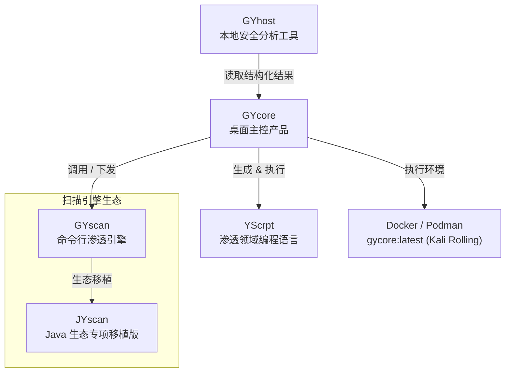

# GYcore

<div align="center">
  
</div>

<div align="center">


</div>

> GYscan 团队的核心 AI 自动化渗透测试产品

GYcore 是一个跨平台（Linux / Windows / macOS）桌面应用，让 AI Agent 在容器里自主完成渗透测试。你只需要描述目标，剩下的由 Agent 去跑。

***

## 目录

- [与兄弟项目的关系](#与兄弟项目的关系)
- [核心特性](#核心特性)
- [快速开始](#快速开始)
- [使用指南](#使用指南)
- [Skills 专家指令集](#skills-专家指令集)
- [运行环境说明](#运行环境说明)
- [开发者文档](#开发者文档)
- [开源协议](#开源协议)

***

## 与兄弟项目的关系

GYcore 是 GYscan 团队渗透产品线的**桌面主控端**。以下仓库同属 [github.com/xiguayiqiu](https://github.com/xiguayiqiu) 组织，围绕同一目标协同：

| 项目                                                 | 定位                       | 与 GYcore 的关系                                                |
| -------------------------------------------------- | ------------------------ | ----------------------------------------------------------- |
| **[GYcore](https://github.com/xiguayiqiu/GYcore)** | 跨平台桌面 AI 渗透平台（本仓库）       | —                                                           |
| **[GYscan](https://github.com/xiguayiqiu/GYscan)** | 命令行渗透引擎                  | GYcore 的 Agent 在容器中调用 GYscan 执行具体扫描，GYscan 专注模块与 payload 质量 |
| **[JYscan](https://github.com/xiguayiqiu/JYscan)** | 面向 Java 生态的专项 GYscan 移植版 | 作为 GYscan 的补充模块，GYcore 可按需下发到目标容器                           |
| **[GYhost](https://github.com/xiguayiqiu/GYhost)** | 本地安全分析工具                 | GYcore 的报告面板消费 GYhost 产出的结构化数据做图表渲染                         |
| **[YScrpt](https://github.com/xiguayiqiu/YScrpt)** | 自研渗透领域编程语言               | GYcore 的 Agent 可生成 YScrpt 脚本并在容器内执行，比原生 Bash 更适合自动化渗透场景     |

关系图：



***

## 核心特性

- **AI Agent 对话**：多 Agent 管理，每个 Agent 可绑定独立容器 / 模型 / 角色设定，思考过程流式实时展示
- **自主渗透任务**：Agent 规划 → 命令执行 → 结果观察 → 再规划，循环直到目标完成或触达步数上限；全部步骤可回放、可中断
- **容器原生终端**：基于 PTY 的 xterm.js 终端会话，支持本地 shell 和容器 shell 双模式；Agent 执行的每一条命令都在独立容器中，互不污染
- **容器生命周期管理**：Docker / Podman 双后端，镜像下拉、容器启停、capability 追加（`NET_RAW` / `NET_ADMIN`）、命名卷持久化
- **推理模型流式输出**：兼容 deepseek、qwen 等多种推理模型，`reasoning_content` / `thinking` 字段统一处理
- **跨平台桌面**：Linux (Waybar 图标自安装)、Windows (任务栏图标)、macOS (Dock 图标) 三端 UI 与打包
- **安全边界**：Agent 被限定在 IT / 网络安全领域，非技术话题主动拒绝；命令输出和上下文按 token 截断，避免推理循环失控
- **Skills 专家指令集**：可独立启停的专家级 Prompt 包——Nmap 扫描、Web 漏洞、AD 域渗透、密码爆破、Metasploit、渗透报告撰写等内置 6 个专家模式，可一键导入/导出/自定义

***

## 快速开始

### 1. 下载 & 安装

从 [GitHub Releases](https://github.com/xiguayiqiu/GYcore/releases) 下载对应平台的安装包：

| 平台                   | 包类型              | 安装方式                                                       |
| -------------------- | ---------------- | ---------------------------------------------------------- |
| **Linux (deb/rpm)**  | `.deb` / `.rpm`  | `sudo dpkg -i GYcore_*.deb` / `sudo rpm -ivh GYcore-*.rpm` |
| **Linux (AppImage)** | `.AppImage`      | 加执行权限后直接运行                                                 |
| **Windows**          | `.msix` / `.exe` | 双击安装                                                       |
| **macOS**            | `.dmg`           | 拖入 Applications 目录                                         |

### 2. 配置模型

首次启动会弹出设置对话框，填写以下两项：

| 配置项         | 说明                                                               |
| ----------- | ---------------------------------------------------------------- |
| **API 地址**  | 兼容 OpenAI 接口的 LLM API Endpoint（支持 deepseek、qwen、glm、本地 Ollama 等） |
| **API Key** | 对应供应商的 API 密钥                                                    |
| **模型**      | 具体模型名（如 `deepseek-reasoner`、`qwen-plus`、`ollama/qwen2.5`）        |

配置可随时通过右上角设置按钮修改。

### 3. 启动工作容器

GYcore 的 Agent 在 Docker / Podman 容器中执行命令。首次使用需要构建工作容器：

```bash
# Docker
docker build -t gycore:latest -f gycontaniner/docker/Dockerfile .

# Podman
podman build -t gycore:latest -f gycontaniner/podman/Containerfile .
```

> 容器基于 Kali Rolling，内置 `kali-linux-labs` + `kali-linux-default` 两个元包，覆盖 nmap、metasploit、sqlmap、nikto、nuclei、ffuf 等全套渗透工具。

### 4. 开始第一个任务

在主界面左侧点击 **＋** 新建 Agent，选择刚才构建的容器，在右侧输入你的目标描述：

```
扫描 192.168.1.0/24，识别所有存活主机和开放端口，对发现的 Web 服务做漏洞检测
```

Agent 会自主规划步骤、调用工具、观察结果、循环推进。你可以随时暂停、接管终端、或在对话中追问。

***

## 使用指南

### 创建 Agent

每个 Agent 是一条独立的渗透管线：

| 字段             | 说明                           |
| -------------- | ---------------------------- |
| **名称**         | Agent 标识，如 `内网渗透-1`          |
| **容器**         | 绑定的 Docker / Podman 容器       |
| **模型**         | 对话与推理使用的 LLM                 |
| **角色设定**       | 可选，给 Agent 一个专业定位（如"资深红队队员"） |
| **启用的 Skills** | 勾选要启用的专家指令集，任务启动时自动注入        |

### 对话 vs 自主任务

- **对话模式**：直接在聊天区提问，Agent 回答但不执行容器命令
- **自主任务**：点击 **"▶ 开始任务"** 按钮，Agent 进入循环执行状态——thought（思考）→ command（执行）→ observation（观察）→ 下一轮 thought，直到任务完成或达到步数上限

### 终端

- **本地 shell**：宿主系统的终端，适合 git、文件管理等操作
- **容器 shell**：工作容器内的 PTY 终端，Agent 执行的每一条渗透命令都在这里
- 两者可通过顶部 Tab 切换，Agent 执行时的终端输出会实时推送到对应面板

### 报告

任务完成后，Agent 会自动整理 findings、风险等级、修复建议到报告面板，可导出为 Markdown / JSON。

***

## Skills 专家指令集

Skills 是 GYcore 的核心差异化能力——每个 skill 是一段经过实战打磨的 Prompt，定义某个渗透场景下的完整工作方法。

### 内置 Skills

| Skill         | 适用场景                                             |
| ------------- | ------------------------------------------------ |
| Nmap 扫描专家     | 端口发现、服务识别、版本探测、脚本扫描、OS 指纹                        |
| Web 漏洞利用      | SQL 注入、XSS、文件上传、命令执行、逻辑漏洞、OWASP Top 10           |
| AD 域渗透        | Kerberoasting、AS-REP、DCSync、Golden Ticket、横向移动   |
|  密码爆破         | Hydra / Medusa / John the Ripper / Hashcat 场景化参数 |
| Metasploit 精通 | payload 选择、exploit 匹配、post-exploitation、后渗透持久化   |
| 渗透报告撰写        | 结构化 Findings → 风险评级 → 修复建议的报告模板                  |

### 管理面板

主界面 Rail 栏点击 **Skills** 图标进入管理面板：

| 操作              | 说明                                    |
| --------------- | ------------------------------------- |
| **启用/禁用**       | 每个 skill 右侧的橘红色 toggle switch，即时生效    |
| **排序**          | 上移/下移箭头按钮，控制 skills 在 Agent 上下文中的出现顺序 |
| **筛选**          | 顶部 chip 一键切换「全部 / 已启用 / 已禁用」          |
| **详情查看**        | 点击卡片查看完整的 Prompt 指令集                  |
| **导入 SKILL.md** | 从 Markdown 文件导入新 skill（格式不对会被拒绝）      |
| **导出 .md**      | 详情弹窗 footer 按钮，下载为标准格式的 Markdown 文件   |

### 创建自定义 Skill

两种 Markdown 格式任选其一：

**格式 A：YAML front matter（推荐）**

```yaml
---
name: my_custom_skill
desc: 一句话描述这个 skill 做什么
tags: [tag1, tag2]
prompt: |
  这里写完整的 Prompt 指令集。
  每行以两个空格开头。
  可以写多行、分步骤、列举工具和参数。
---
```

**格式 B：`##`** **标题分隔（批量）**

```markdown
## Skill 名称

Prompt 内容……

## 另一个 Skill

Prompt 内容……
```

导入后立即生效，可随时启停。

### Skills 如何影响 Agent

任务启动时，GYcore 会把所有**已启用** skills 的完整内容注入到 LLM 的 system prompt 里。但**是否参考、参考哪个、怎么用**完全由 LLM 自主决策——不会强制调用。你可以在任务日志里看到类似：

```
[SKILLS] 注入 3 个已启用 skills 到 LLM 上下文
```

> 想了解 Skills 后端实现、Markdown 解析流程、ID 生成算法、上下文注入细节？参阅 [Developer.md → Skills 实现细节](./Developer.md#skills-实现细节)。

***

## 运行环境说明

> **最佳运行环境：Kali Linux / Parrot OS / BlackArch 实体机**
>
> GYcore 桌面端本身跨平台，但核心工作——容器内自主渗透——依赖原生 Linux 的完整工具链与网络能力。

| 发行版            | 特点                              | 与 GYcore 容器兼容性                         |
| -------------- | ------------------------------- | -------------------------------------- |
| **Kali Linux** | Nmap 官方所属，渗透工具链最成熟，文档最全         | 容器基于 `kalilinux/kali-rolling`，与宿主机完全同源 |
| **Parrot OS**  | 轻量，侧重隐私与匿名（AnonSurf），自带大量隐私工具   | Debian 兼容，容器可直接复用 Kali 元包              |
| **BlackArch**  | Arch Linux 基础，包数量最多（2800+），滚动更新 | Arch 系，容器用 Kali 元包即可，宿主机工具可直接下发        |

虚拟机或 WSL2 环境常遇到网桥、网卡混杂模式、VPN 路由穿透、原生 raw socket 抓包等问题，日常开发测试可以，**生产级渗透任务务必在实体机上运行**。

***

## 开发者文档

源码编译、架构解读、Service 实现、打包发布等开发相关内容请查阅 [Developer.md](./Developer.md)。

***

## 开源协议

本项目基于 [Apache License 2.0](./LICENSE) 开源。
